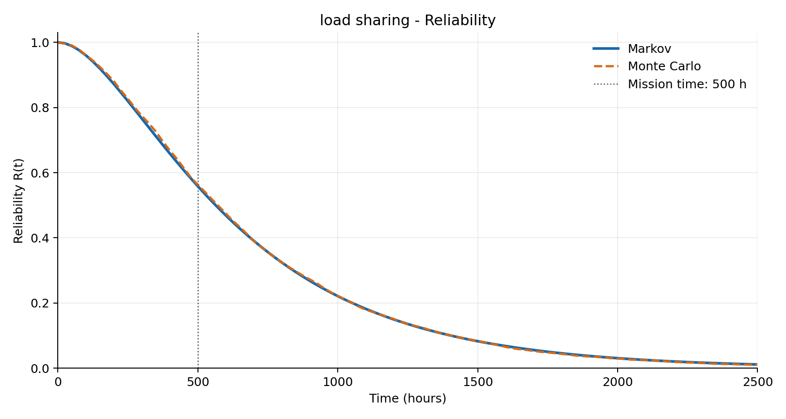
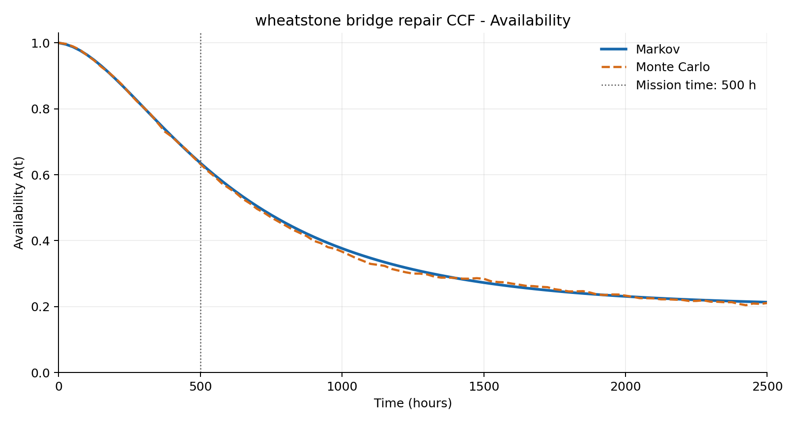
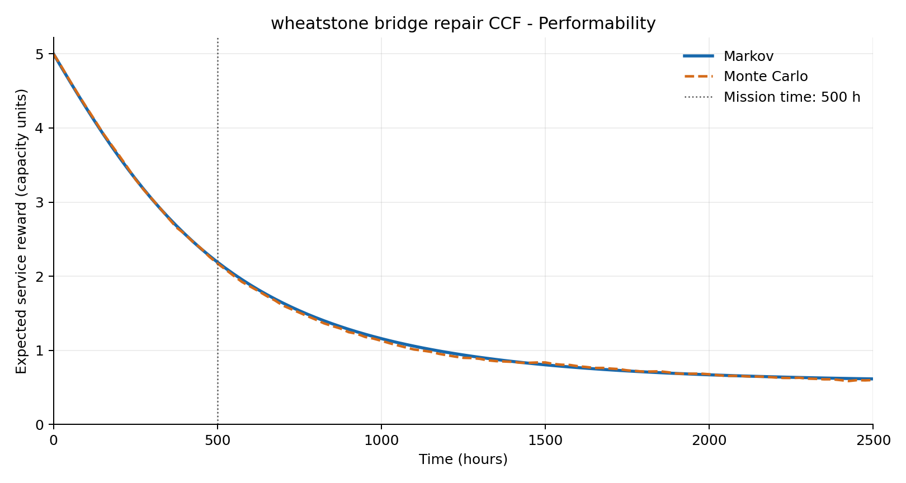

# Reliability Model Solver

Calculates reliability, availability, and expected service capacity from JSON scenarios.

## Run

Requires Python 3.12.

```powershell
python -m venv .venv
.\.venv\Scripts\python.exe -m pip install -r requirements.txt
.\.venv\Scripts\python.exe main.py
```

Options:

- `--input PATH`: scenario file; defaults to `data/scenarios.json`.
- `--output-dir PATH`: output directory; defaults to `output`.
- `--simulations N`: override the number of Monte Carlo repetitions per scenario.
- `--seed N`: use a fixed seed for repeatable simulations; otherwise, each run uses fresh randomness.

On Linux or macOS, use `.venv/bin/python` instead of `.venv\Scripts\python.exe`.

## Input data

Settings and scenarios are defined in [data/scenarios.json](data/scenarios.json).

| Setting | Meaning | Default |
|---|---|---:|
| `mission_time` | Mission time, included in the results (hours) | 500 |
| `horizon` | Simulation duration (hours) | 2500 |
| `time_points` | Number of evenly spaced sampling times | 101 |
| `simulations` | Monte Carlo repetitions per scenario | 5000 |

Scenario fields:

- `name`: a unique nonempty identifier.
- `topology`: `Series`, `M-of-N`, or `Wheatstone Bridge`.
- `parameters`: voting threshold `m` and component count `n`, where applicable.
- `nodes`: component names with failure rate `lam`, repair rate `mu`, and optional `capacity` (default 1).
- `ccf_groups`: optional common-cause groups with `name`, `affected_nodes`, and `common_rate`.
- `load_sharing_factor`: optional stress multiplier, default 1; values above 1 require a 1-of-2 system.

Rates are per hour; `mu=0` disables repair. Rates and capacities must be finite and nonnegative. Mission time must fall within the simulation horizon.

The default input contains 16 topology/repair/common-cause scenarios and one load-sharing scenario.

## Results

Each run saves solver values for each scenario, metric, and sampling time to [output/results.csv](output/results.csv), overwriting the previous results. Charts are saved to `output/plots/`, one for each scenario and metric.

CSV columns: `scenario`, `metric`, `time`, `markov`, `monte_carlo`, `bayesian`, and `analytical`. An empty cell means the solver does not support that scenario or metric.

| Metric | Meaning | Units |
|---|---|---|
| `reliability` | Probability of no whole-system failure before time `t`; component repairs before that failure remain enabled. | Probability |
| `availability` | Probability that the system is operating at time `t`, including recovery. | Probability |
| `performability` | Expected sum of healthy component capacities while the system is operating; zero during downtime. | Capacity units |

The default input produces 5,151 rows. See [docs/model.md](docs/model.md) for solver behavior and assumptions.

## Example results

These images were generated by running `main.py` with 5,000 Monte Carlo repetitions per scenario and copied from `output/plots/`. Solid lines show Markov results; dashed lines show Monte Carlo estimates.

### Load sharing

Reliability of the two-component parallel system with stress factor 5.



### Availability

Availability of the repairable Wheatstone bridge with common-cause failures.



### Service capacity

Expected service capacity of the same bridge.



## Source layout

```text
main.py                    Read options, run scenarios, save results
analysis/inputs.py         Read JSON and check initial inputs
analysis/runner.py         Execute solvers and assemble result rows
analysis/artifacts.py      Save CSV results
analysis/plots.py          Save result charts
data/scenarios.json        Scenario data and run settings
core/                      Components, topology construction, and simulation
models/                    Markov, Bayesian, and analytical solvers
utils/helpers.py           Sample simulation timelines
docs/model.md              Model definitions and assumptions
docs/images/               Example result charts
requirements.txt           Runtime dependencies
output/                    Saved results
```
